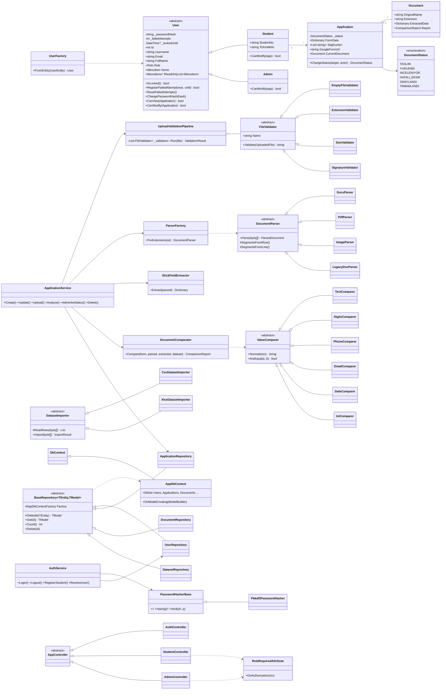
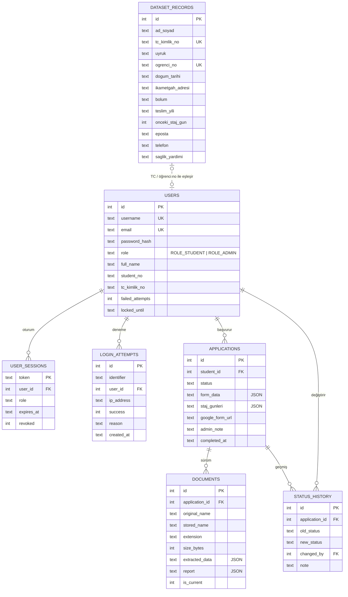
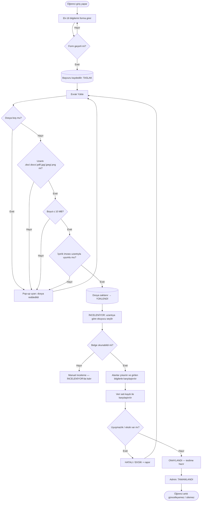
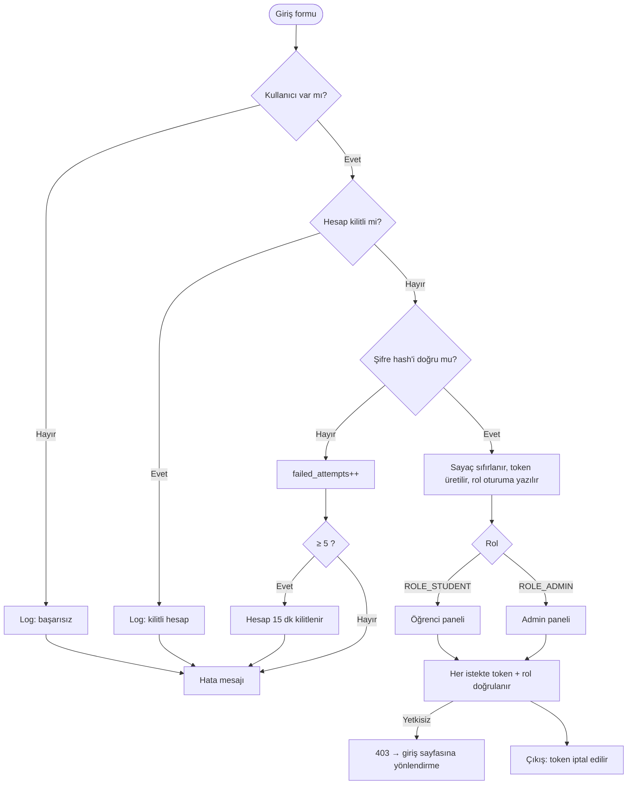
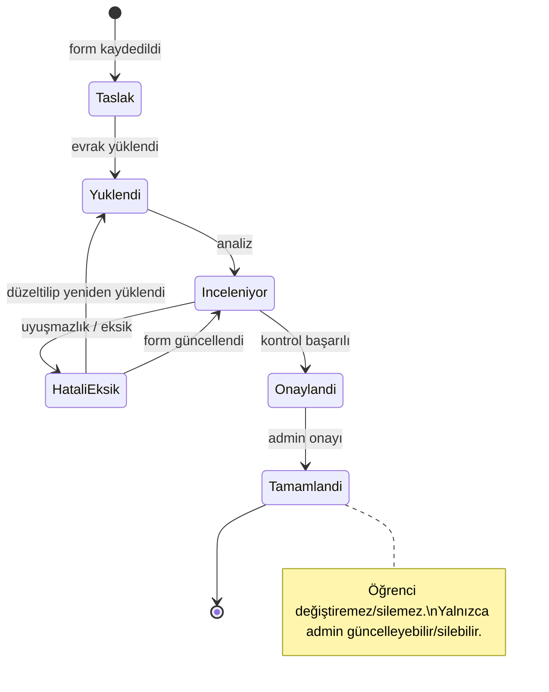
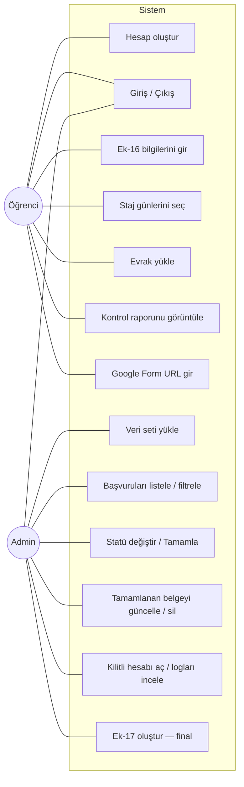

# Diyagramlar (Mermaid)

> Bu diyagramlar https://mermaid.live adresinde veya GitHub/VS Code (Mermaid eklentisi) ile görüntülenebilir;
> PNG olarak dışa aktarıp rapora ekleyebilirsiniz.

## 1. Sınıf Diyagramı (NYP prensipleri)

## 2. Veritabanı (ER) Diyagramı

## 3. Akış Diyagramı — Evrak yükleme ve kontrol

## 4. Akış — Oturum açma ve yetkilendirme

## 5. Durum (Statü) Diyagramı

## 6. UML Kullanım Durumu (Use Case)

